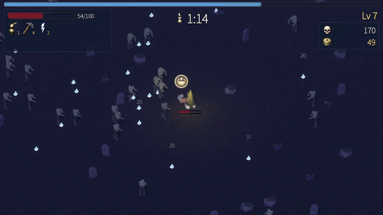
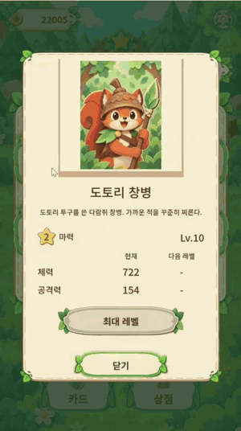

# open-game-works

[English](README.md)

미리 만들어 둔 코어 위에서 AI 에이전트가 상용 수준의 서버-클라이언트 게임을 만든다.

https://github.com/user-attachments/assets/116aebfd-d82f-42f3-be5e-815e5336c257

<table>
  <tr>
    <td align="center" width="50%"><br><a href="https://github.com/wnsrn3436/open-game-works-game-iso-survivors">iso-survivors</a>: 아이소메트릭 3D 호드 서바이벌</td>
    <td align="center" width="50%"><br><a href="https://github.com/wnsrn3436/open-game-works-game-mana-clash">mana-clash</a>: 1대1 카드 배틀</td>
  </tr>
  <tr>
    <td align="center" width="50%"><br><a href="https://github.com/wnsrn3436/open-game-works-game-pong">pong</a>: CPU와 대결하는 패들 게임</td>
    <td align="center" width="50%"><br>card-duel: AI와 겨루는 실시간 카드 배틀. open-game-works의 아주 초기 버전으로 만들었다 (저장소 비공개)</td>
  </tr>
</table>

여러 게임이 똑같이 다시 만들게 될 기능(인프라, 라이브 운영, 스토어 정책, 메타 시스템)은 **코어**(core)로 미리 만들어 두고, 에이전트는 게임플레이만 **콘텐츠 코드**(content code)로 작성한다. 사람이 `create game: <game>` 같은 명령 하나를 내리면, 그 명령을 받은 에이전트가 **리드 에이전트**(lead agent)가 된다. 리드 에이전트는 역할별 하위 에이전트를 부르며 수정, 플레이, 판정의 루프를 멈출 때까지 돌리고, 끝나면 보고한다.

이 저장소는 하네스다. 에이전트가 따르는 규칙, 에이전트가 읽는 스킬과 코어 모듈 명세, 설정, 그리고 판단이 필요 없는 일을 맡는 CLI `ogw`가 들어 있다. 이 폴더에서 연 Claude Code 또는 Codex 세션에서 쓴다.

## 현재 상태

open-game-works는 한창 개발 중이다. 지금까지는 macOS에서, Claude Code와 Claude Opus 5.5(high effort) 조합으로만 테스트했다. 플레이 에이전트와 번역 하위 에이전트는 `settings.json` `agents` 설정대로 Claude Sonnet 5.5(medium effort)로 실행된다. Codex CLI는 하네스 설정에서 지원하지만 테스트하지 않았다. `build` 명령은 아직 실행한 적이 없어서, 이 명령으로 빌드하거나 배포한 게임은 아직 없다. 명령, 설정, 파일 형식은 앞으로 바뀔 수 있다.

## 빠른 시작

### 필요한 것

- macOS(Apple silicon Mac)
- Node.js 24 이상
- Git
- GitHub CLI(`gh`), 로그인 상태
- Docker와 `docker buildx`
- uv
- Claude Code, 로그인 상태

나머지 호스트 조건은 `update env`가 확인하고, 엔진과 고정된(pinned) 도구도 `update env`가 직접 내려받는다.

### 설치

```sh
mkdir open-game-works && cd open-game-works
git clone https://github.com/wnsrn3436/open-game-works-core.git
git clone https://github.com/wnsrn3436/open-game-works-core-impl.git

cd open-game-works-core/tools && npm ci && cd ..
export PATH="$PWD/tools/bin:$PATH"   # 현재 셸에만 적용된다. 계속 쓰려면 전체 경로를 셸 프로필에 넣는다

# 플레이·판정 에이전트가 쓰는 Claude Code 장기 토큰: 만들고, 복사하고, 저장한다
claude setup-token
pbpaste | tr -d '[:space:]' | ogw secret set --harness claude-code-oauth-token

claude
```

### 게임 만들기

그 Claude Code 세션에서 다음 명령을 하나씩 내린다.

```
update env
setup game: block-drop 모바일용 낙하 블록 퍼즐 게임, 한국어와 영어 지원
create game: block-drop
```

- `update env`: 이 호스트를 확인하고, 엔진, 고정된 도구, 생성 방법을 `<workspace>/.ogw/`에 설치해 측정한 뒤, 이 호스트에 맞는 하네스 설정을 제안한다. 호스트마다 한 번 실행한다.
- `setup game`: `games/<game>/`에 게임 저장소를 만들고, 스스로 정할 수 없는 것을 묻는다. 레퍼런스 게임과 그 게임플레이 영상(파일 또는 YouTube URL)도 이때 받는다.
- `create game`: 루프가 멈출 때까지 돌리고, 결과를 main에 병합한 뒤 보고한다. 중간에 사람을 기다리지 않는다.

참고:

- 시작할 때 Hugging Face 토큰은 필요 없다. 토큰은 `trellis2` 방법(3D 모델)에만 필요한데, 이 방법이 쓰는 DINOv3 가중치에 접근 제한(gated)이 걸려 있기 때문이다.
- 로컬 모델은 쓰지 않아도 된다. 자세한 내용은 [로컬 모델](#로컬-모델)에 있다.
- 전체 요구 사항, 예제 게임, 시크릿, `update env`의 단계별 동작은 [자세한 설치](#자세한-설치)에 있다.

## 동작 방식

설계는 `AGENTS.md`의 몇 가지 원칙을 따른다.

- 목표는 상용 게임 수준의 재미와 완성도다. 재미는 판정 에이전트가 직접 플레이해서 판단하고, 완성도는 자동 검사가 판단한다.
- 자동 검사로 확인할 수 있는 것은 코드를 작성하는 시점에 자동 검사로 확인한다. 근거의 우선순위는 자동 검사, 텔레메트리, LLM 의견 순이다. 확인하지 못한 것은 실패가 아니라 unknown으로 기록한다.
- `ogw`는 판단이 필요 없는 일을 맡는다. 설정, 기록, JSON, CSV 읽기와 쓰기, 개수 세기, 계산, 비교, 인스턴스 실행, 작업 일정 관리, 상태 전이가 여기에 속한다. 에이전트는 판단이 필요한 일만 한다.
- 서로의 결과를 기다리지 않는 작업은 함께 실행한다.

### 루프

`create game`과 `update game`은 루프로 게임을 개발한다. 반복(iteration) 한 번은 다음과 같다.

```
사람 -- 명령 하나 --> 리드 에이전트 (사람이 연 Claude Code 또는 Codex 세션)
                         |
  +-- 반복 한 번 -----------------------------------------------------
  | 1. 콘텐츠 에이전트: design.md, 클라이언트·서버 콘텐츠 코드, 데이터,
  |    contract, play-guide.md를 고치고 플레이스홀더 리소스를 넣음
  | 2. 자동 검사: 회귀 테스트, 정적 검사, 완성도 검사, row simulation
  |    -> 게이트: pass 또는 fail
  | 3. 플레이 에이전트: 이번 커밋의 인스턴스를 실제 입력으로 플레이
  | 4. 판정 에이전트: 새 컨텍스트. 기준 게임과 블라인드 A/B 비교,
  |    레퍼런스 게임의 게임플레이 영상과 비교
  | 5. ogw: 결함 목록, 루프 반복 기록, 중지 판정
  +-------------------------------------------------------------------
     병행: 리소스·번역 하위 에이전트. `ogw loop sync`가 그 결과를 병합
                         |
  중지: success, repeated defect, oscillation, plateau, limit reached
                         |
  루프 종료 기록 -> main에 병합 -> 사람에게 보고
```

1. **콘텐츠 에이전트**가 `design.md`, 클라이언트·서버 콘텐츠 코드, 데이터, contract를 함께 고치고 `play-guide.md`를 게임에 맞춰 유지한다. `create game`의 첫 반복에서는 먼저 `setup game`이 저장한 요청으로 `brief.md`를 쓴다. 리소스가 필요하면 플레이스홀더 리소스를 넣고 최종 리소스를 요청한 뒤, 기다리지 않고 진행한다.
2. **자동 검사**를 실행한다(아래 표). 회귀 테스트, 정적 검사, no blocker, full flow 중 하나라도 실패하면 플레이와 판정을 건너뛰고 바로 결함 목록으로 간다.
3. **플레이 에이전트**가 `play-guide.md`를 읽고, 같은 커밋의 인스턴스 여러 개를 자동화 채널을 통한 실제 입력으로 플레이한 뒤, 총점이 아니라 관찰마다 피드백을 쓴다.
4. **판정 에이전트**는 새 컨텍스트에서 시작해 두 인스턴스 `A`, `B`를 플레이한다. 어느 쪽이 이번 커밋이고 어느 쪽이 기준 게임(baseline game)인지는 알려 주지 않는다. 재미 요소(game feel, tension and release, progression, one more run, no friction, presentation)마다 승자를 고르고, 각 요소를 정해진 순간(`first 30000ms`, `core action`, `first failure`, `first reward`, `restart`)의 레퍼런스 게임 게임플레이 영상과 비교한다. 플레이 에이전트와 판정 에이전트는 `brief.md`와 `design.md`를 보지 못한다. 3단계와 4단계는 함께 실행되며(`ogw loop evaluate`), 판정 에이전트는 플레이 피드백을 받지 않는다.
5. **`ogw`**가 검사 실패, 플레이 피드백, 판정 결과를 결함 목록으로 정리하고, 루프 반복 기록을 쓰고, 다음 기준 게임을 정하고, 루프를 멈출지 판정한다.

루프는 다음 이유 중 하나로 멈춘다. success(성공), repeated defect(같은 결함 반복), oscillation(수정과 재발의 반복), plateau(개선 정체), limit reached(게임 설정 `loopIterationLimit` 도달), stopped by human(사람이 중지). 성공하려면 후보 반복(candidate iteration)이 있어야 한다. 후보 반복은 판정 결과가 레퍼런스 게임 수준에 이르고 기준 게임보다 나쁘지 않으며, no placeholder를 뺀 완성도 요소가 모두 통과하고, 추가로 부르는 성공 확인 판정 에이전트들도 레퍼런스 게임 수준이라고 판정한 반복이다. 리소스 작업과 번역 작업은 루프를 기다리게 하지 않는다. 그래서 후보 반복 시점에 끝나지 않은 작업이 있었다면, 그 작업을 병합한 상태에서 콘텐츠 수정 없이 확인 반복(confirmation iteration)을 한 번 더 돌려 성공을 다시 판정한다.

루프가 멈추면 리드 에이전트는 진행 중인 리소스 작업과 번역 작업을 기다린 뒤 루프 종료 기록 `records/loops/<run>/end.md`를 쓰고, 고른 커밋을 main에 병합하고, 보고한다. 플레이스홀더 리소스나 누락·만료된 번역이 남아 있으면 실패로 보고한다.

게임 저장소의 브랜치: main은 항상 루프를 통과한 최신 코드다. `create game`과 `update game`은 명령마다 자기 브랜치 `loop/<run>`에서 작업한다. 한 게임에서는 `create game`, `update game`, `build` 중 하나만 진행된다. ID 레지스트리는 별도 브랜치 `id-registry`에 있다.

### 자동 검사

| 검사 | 확인하는 것 | 방법 |
|---|---|---|
| 회귀 테스트 (regression test) | 콘텐츠 에이전트가 기능과 함께 작성한 클라이언트·서버 테스트 전체 | 테스트 실행 |
| 정적 검사 (static check) | 코드와 데이터에서 도구가 정확히 판정할 수 있는 규칙. 예: 데이터 검사, `lint`, `type check`, `forbidden GDScript API` | 정적 분석 |
| no blocker | 크래시, 소프트락, 오류 화면처럼 진행을 막는 문제가 없음 | 봇 플레이테스트 |
| performance | 목표 FPS를 유지하고 로딩이 제한 시간 안에 끝남 | 런타임 프로파일링 |
| no placeholder | 플레이스홀더 리소스, 누락된 번역, 만료된 번역이 남아 있지 않음 | 프로젝트 검사 |
| full flow | 첫 실행, 튜토리얼, 메인 루프, 저장, 재접속까지 끊기지 않고 이어짐(실시간 게임은 상대 연결 끊김, 매치메이커 연결 끊김, 앱 재시작도 포함하고, 해당 기능을 쓰는 게임은 방 매치와 다른 사용자와의 교류도 포함) | 봇 플레이테스트 |
| UI quality | 지원하는 모든 해상도, 세이프 에어리어, 언어에서 UI가 잘리거나 겹치지 않고, 화면 키보드가 포커스된 입력란을 가리지 않으며, 게임패드를 지원하면 모든 버튼을 게임패드로 누를 수 있음 | 해상도·언어·화면 키보드별 캡처, 게임패드 포커스 검사 |
| row simulation | 레벨 같은 테이블의 각 행을 시드마다 봇이 화면 없이 끝까지 플레이해 풀 수 있는지와 난이도 지표를 측정 | 헤드리스 시뮬레이션 |

no blocker부터 UI quality까지 다섯 행이 완성도 검사(completeness check)다.

### 하드닝과 빌드

`build: <game> <DEV, STG, PROD>`는 사람에게 건넬 빌드를 만든다.

1. 서버 하드닝 에이전트와 클라이언트 하드닝 에이전트가 contract를 기준으로 콘텐츠 코드를 고친다. 대상은 콘텐츠 에이전트가 서버까지 작성하면서 생기는 문제다. 서버 입력 검증 누락, 클라이언트에 있는 권위 로직, contract와 다른 처리가 그런 예다. 자기 폴더(`server/` 또는 `client/`) 밖을 고쳐야 풀리는 문제는 하드닝 기록에 남기고, 콘텐츠 에이전트가 고친 뒤 하드닝을 다시 한다.
2. 하드닝된 코드로 루프 2~4단계를 PostgreSQL로 한 번 실행한다. 회귀 테스트, 정적 검사, no blocker, full flow 중 하나가 실패하거나 판정 결과가 기준 게임보다 나쁘면 루프로 돌아간다.
3. 빌드 시점 검사를 실행한 뒤, 고른 플랫폼(`android`, `ios`, `web`, `windows`, `macos`, `linux`)을 이 호스트에서 빌드한다. iOS와 macOS는 Mac에서만 빌드한다. 산출물은 게임 저장소의 `builds/<env>-<version>/<platform>/`에 들어가며 커밋하지 않는다.
4. 하드닝된 코드를 main에 커밋하고 `dev-<version>`, `stg-<version>`, `prod-<version>` 태그를 붙인다.
5. DEV와 STG 빌드는 그 환경의 서버도 배포한다. PROD는 사람이 배포한다.

android, ios, macos, windows의 STG와 PROD 빌드는 서명된 산출물을 만든다(web과 linux는 서명하지 않는다). 서명 값이 없는 android, macos, windows의 DEV 빌드는 무료 서명을 쓴다. PROD 빌드는 하드닝을 다시 하지 않고 STG에서 확인한 커밋을 그대로 빌드한다. 하위 호환성(contract, 데이터, 저장 스키마)은 마지막 PROD 빌드를 기준으로 검사한다. `--bundle-for <app version>`은 번들 패치, 즉 설치된 앱에 앱 업데이트 없이 보내는 리소스와 데이터를 만든다.

### 환경

| 환경 | 용도 | 서버 | DB | 외부 서비스 | DEV 코드 | 배포 주체 |
|---|---|---|---|---|---|---|
| LOCAL | 루프 | 인스턴스마다 하나 | SQLite | fake 어댑터 | 포함 | 러너(`ogw instance start`) |
| DEV | 사람에게 건네는 DEV 빌드 | 공용 하나 | PostgreSQL | 게임 설정 `environments.DEV.adapters`가 고른 어댑터 | 포함 | `build` (`ogw deploy`) |
| STG | PROD와 같은 코드로 확인, PROD 문제 수정 확인 | 공용 하나 | PostgreSQL | sandbox 어댑터(sandbox가 없는 키와 `push-apns`는 real 어댑터) | 제외 | `build` (`ogw deploy`) |
| PROD | 서비스 | 공용 | PostgreSQL | real 어댑터 | 제외 | 사람(PROD 빌드 리포트를 따라) |

PROD 문제는 최신 main으로 띄운 인스턴스에서, PROD 사용자를 스냅숏으로 복제해(`ogw clone`) 재현한다. PROD에는 영향을 주지 않는다.

## 구조

### 코어와 콘텐츠 코드

- **코어(core)**: 여러 게임이 공유하는 기능의 구현. 게임플레이 루프 밖의 것만 담고, 그것을 쓰는 게임보다 먼저 만들어 둔다.
- **콘텐츠 코드(content code)**: 한 게임의 코드. 에이전트는 코어 위에서 여기에 게임플레이 루프(그 게임의 플레이 규칙과 계산)를 작성한다.

| 코어가 맡는 영역 | 예 |
|---|---|
| 인프라 (infra) | 서버 요청 처리와 저장, 로그인, 네트워크와 실시간 연결, 업데이트, 클라이언트 UI, 입력, 연출 도구, 플랫폼 연동, 개발·테스트 도구 |
| 라이브 운영 (live ops) | 점검, 공지, 킬 스위치, 아이템 지급과 회수, 제재, 쿠폰, 라이브 이벤트, 원격 설정, 푸시, 번들 패치 |
| 스토어 정책 (store policy) | 영수증 검증과 환불 처리, 약관 동의, 연령 확인, 계정 삭제, 확률 공개, 스토어 개인정보 공개, 추적 권한 |
| 메타 시스템 (meta system) | 아이템, 상점, 우편함, 미션, 출석, 가챠, 랭킹, 레이팅, 친구, 길드 |

### 계층

| 계층 | 내용 | 정의 위치 |
|---|---|---|
| 클라이언트 코어 | 게임들이 공유하는 클라이언트 기능, 43개 모듈. 예: `UICore`, `NetworkCore`, `AuthCore`, `PaymentCore`, `RealtimeCore`, `TutorialCore`, `QACore`(디버그 화면, 치트, 자동화 채널). 엔진마다 구현이 따로 있으며 첫 엔진은 Godot이다. 대상 엔진은 Godot, Three.js, Phaser, Unity, Unreal이다. 게임별 정의는 데이터와 훅으로 들어온다 | `skills/client-core/` |
| 서버 코어 | TypeScript로 작성한 API 서버와 실시간 서버, 42개 모듈. 예: `routing`, `auth`, `storage`, `item-ledger`, `iap`, `gacha`, `matchmaker`, `p2p-signaling`, `admin-api`. 사용자 아이템은 아이템 원장으로만 바뀐다. DB는 어댑터 뒤에 있어 로컬은 SQLite, DEV·STG·PROD는 PostgreSQL을 쓴다. 실시간은 P2P로 시작하며, 서버 권위 실시간 서버로 바꿀 수 있도록 실시간 메시지 contract와 전송 계층을 분리해 둔다. 외부 서비스마다 fake, sandbox, real 어댑터가 있다 | `skills/server-core/` |
| contract | 클라이언트와 서버 사이, 클라이언트끼리(실시간) 주고받는 protobuf 메시지. 기본 proto는 코어에 있고, 게임은 자기 contract를 `contract/`에 쓴다. contract tool이 클라이언트 코드와 서버 코드를 생성한다 | `skills/contract/` |
| 데이터 | CSV 테이블, enum, 불변식, 언어별 번역, 용어집, 그리고 브랜치 `id-registry`의 ID 레지스트리. data tool이 코드, 데이터 proto, 테이블·번역 바이너리를 생성한다. 콘텐츠 코드에는 게임 데이터 값을 넣지 않는다 | `skills/data/` |
| 리소스 | 런타임에 리소스 키로 불러오는, 코드·데이터·contract가 아닌 모든 파일(2D, 3D, 애니메이션, VFX, 오디오, 햅틱, 타이포그래피, 맵, 씬, 프리팹, 플랫폼). 콘텐츠 에이전트가 플레이스홀더 리소스를 넣고, 리소스 하위 에이전트가 최종 리소스로 바꾼다 | `skills/resource/` |
| 콘텐츠 코드 | 한 게임의 게임플레이: 클라이언트 콘텐츠 코드(Godot에서는 GDScript), 서버 콘텐츠 코드(TypeScript), 씬과 프리팹. DEV 코드는 `client/dev/`와 `server/dev/`에만 둔다 | `skills/client-content/`, `skills/server-content/` |

최종 리소스는 `settings.json` `resourceGeneration`의 생성 방법으로 만든다. 방법이 내려받는 파일은 고정(pin)되어 있고(저장소 리비전, SHA-256이 붙은 모델 파일, 패키지 버전), `update env`가 이를 설치하고 호스트에서 방법마다 측정한다. 로컬 모델과 Blender는 네트워크를 막은 샌드박스에서 실행한다.

| 방법 | 종류 | 리소스 타입 |
|---|---|---|
| `flux2-klein` | 로컬 모델 | `image`, `sprite_sheet`, `icon`, `background`, `nine_slice`, `texture`, `skybox`, `app_icon`, `splash` |
| `ace-step` | 로컬 모델 | `bgm` |
| `moss-sfx` | 로컬 모델 | `sfx` |
| `qwen3-tts` | 로컬 모델 | `voice` |
| `trellis2` | 로컬 모델 | `model` |
| `sprite-gen-codex`, `sprite-gen-grok` | 외부 서비스(OpenAI는 `codex` CLI로, xAI API는 `grok` CLI 로그인이나 `XAI_API_KEY`로 호출) | `sprite_animation` |
| `rig-2d` | 절차적 생성 | `rig_animation_2d` |
| `blender` | 절차적 생성 | `model`, `rig`, `animation_3d`, `material` |
| `procedural` | 절차적 생성 | `texture_atlas`, `particle`, `shader`, `material`, `haptic`, `tileset` |
| `font-catalog` | 고정된 카탈로그 | `font` |

출처를 확인할 수 없는 리소스는 쓰지 않으며, 레퍼런스 게임의 화면, 리소스, 이름, 텍스트는 생성 입력으로 쓰지 않는다.

### 저장소

| 저장소 | 내용 |
|---|---|
| [open-game-works-core](https://github.com/wnsrn3436/open-game-works-core) | 하네스(이 저장소): 에이전트 규칙, 스킬, 모듈 명세, CLI `ogw` |
| [open-game-works-core-impl](https://github.com/wnsrn3436/open-game-works-core-impl) | 코어 구현: 클라이언트 코어(Godot), 서버 코어(TypeScript), 기본 proto, contract tool, data tool. 코어 릴리스는 이 저장소의 GitHub Releases다 |
| [open-game-works-game-mana-clash](https://github.com/wnsrn3436/open-game-works-game-mana-clash) | open-game-works로 만든 1대1 카드 배틀 게임 |
| [open-game-works-game-pong](https://github.com/wnsrn3436/open-game-works-game-pong) | open-game-works로 만든, CPU와 대결하는 패들과 공 게임 |

### 코어 릴리스와 게임의 버전 고정

```
 open-game-works-core (하네스)              open-game-works-core-impl (코어)
   skills/client-core/modules/*.md  ----->    client/godot/      클라이언트 코어
   skills/server-core/modules/*.md  ----->    server/core/       서버 코어
   skills/server-core/base-proto.md ----->    proto/             기본 proto
   skills/contract/, skills/data/   ----->    tools/contract-tool/, tools/data-tool/
                                                   |
                                                   |  ogw core release <version>
                                                   v
                                              GitHub Release v<version>
                                                   |
 games/<game>/settings.json "coreVersion"  ------->|  open-game-works-core-releases/에 캐시
                                                   v
 games/<game>/client/core/, server/core/      그 릴리스의 사본, 콘텐츠 코드 옆에 놓임
```

- 게임은 코어 버전, 즉 게임 설정 `coreVersion`만 기록한다. dev run과 빌드 때 `ogw`는 그 버전을 `open-game-works-core-releases/`에서 찾고, 없으면 `settings.json`의 `coreReleaseRepository`에서 GitHub Release를 내려받는다. 내려받은 파일은 해시로 검사한다.
- 코어 버전 하나가 클라이언트 코어, 서버 코어, contract tool, data tool, 코어 설정을 함께 묶으며, 형식은 `<major>.<minor>.<patch>`다. 공개된 릴리스 자산은 바뀌지 않고, 수정은 새 버전으로 낸다.
- `update game`은 게임의 `coreVersion`을 올릴 수 있는 가장 높은 릴리스로 올린다(`ogw core upgrade`). 게임에 PROD 빌드가 있으면 그 빌드와의 하위 호환성을 깨는 버전은 건너뛴다.
- 콘텐츠 에이전트는 코어를 고치지 않는다. 코어가 부족하면 콘텐츠 코드로 우회하고 게임의 `records/core-proposals/`에 코어 제안을 쓴다. 사람이 적용할 제안을 골라 `update core`로 지시하면 명세, 구현, 테스트를 고치고 리뷰한 뒤 새 버전을 릴리스한다.
- `settings.json`의 `useLocalCore`가 `true`이면 `ogw`는 릴리스 대신 `open-game-works-core-impl/`을 쓴다. 코어를 개발할 때만 쓰며, 켜져 있는 동안 루프와 빌드는 시작하지 않는다.

### 역할

리드 에이전트는 사람이 시작한 세션이다. 하위 에이전트는 `ogw agent`로만 시작하며, `settings.json` `agents`에 역할별로 정한 에이전트 CLI, 모델, effort를 쓴다.

<details>
<summary>하위 에이전트 역할 9개</summary>

| 역할 | 설명 |
|---|---|
| 콘텐츠 에이전트 | 루프에서 브리프, 디자인 문서, 클라이언트·서버 콘텐츠 코드, 씬, 프리팹, 데이터, contract, 회귀 테스트, 봇 플레이테스트 시나리오, 플레이 가이드, 게임 설정의 콘텐츠 항목을 쓴다 |
| 리소스 하위 에이전트 | 콘텐츠 에이전트의 지시대로 최종 리소스를 만든다 |
| 번역 하위 에이전트 | 누락된 번역과 만료된 번역을 만든다 |
| 플레이 에이전트 | 실제 입력으로 인스턴스를 플레이하고 피드백을 준다 |
| 판정 에이전트 | 새 컨텍스트에서 플레이하고, 기준 게임 및 레퍼런스 게임 게임플레이 영상과 비교한 판정 결과를 쓴다 |
| 서버 하드닝 에이전트 | 빌드 때 contract를 기준으로 서버 콘텐츠 코드를 하드닝한다 |
| 클라이언트 하드닝 에이전트 | 빌드 때 contract를 기준으로 클라이언트 콘텐츠 코드를 하드닝한다 |
| 코어 에이전트 | 코어를 만들고 고친다 |
| 리뷰 에이전트 | 코어, contract tool, data tool, 하네스 도구의 코드를 정의 문서에 비추어 리뷰하고 지적 사항을 쓴다. 코드는 고치지 않는다 |

</details>

### 스킬

에이전트는 작업별 절차와 규칙을 `skills/`에서 읽는다.

<details>
<summary>스킬 13개</summary>

| 스킬 | 다루는 내용 |
|---|---|
| `host-env` | 호스트 확인, 로컬 모델과 프로그램 설치, 측정, 하네스 설정 수정 제안 |
| `game-setup` | 게임 저장소와 게임 설정 만들기, 요청 저장, 레퍼런스 게임과 게임플레이 영상, 금칙어 목록, 호스트 역량 확인 |
| `game-loop` | 작업 브랜치, 코어 버전 올리기, 하위 에이전트 호출, 러너, 인스턴스 명령, 자동 검사, 측정, 루프 기록, 루프 중지 판정, 보고, PROD 문제 재현 |
| `game-design` | 브리프, 디자인 문서, 플레이 가이드, 코어 제안, 루프 안의 가정, 사람에게 묻지 않고 정하는 기준 |
| `contract` | proto 작성 규칙, 오류 코드, 하위 호환성, contract tool이 생성하는 코드 |
| `data` | CSV 형식, 타입, ID, 시스템 테이블, 번역, 용어집, 데이터에서 생성하는 코드, 데이터 검사 |
| `resource` | 리소스 키, 플레이스홀더 리소스, 리소스 요청, 최종 리소스 제작, 리소스 권리 |
| `client-content` | 클라이언트 콘텐츠 코드 규칙, 서버와의 역할 분담, 결정적 시뮬레이션과 틱 시뮬레이션, 씬과 프리팹, DEV 코드, 자동화 채널, 봇 플레이테스트, row simulation, 클라이언트 회귀 테스트 |
| `server-content` | 서버 콘텐츠 코드 규칙, 입력 검증, 오류 응답, 수집 데이터, 서버 회귀 테스트, 서버 하드닝 대상 |
| `core` | 코어 공통 규칙(명세 형식, 훅, 오류 처리, 코어 설정, 수집 데이터), 코어 버전과 릴리스, 라이선스 매니페스트, `update core` |
| `client-core` | 모듈별 클라이언트 코어 명세, 엔진별 구현 규칙 |
| `server-core` | 모듈별 서버 코어 명세, 어댑터, 서버 시작, 서버 이미지 |
| `build` | 하드닝, 빌드 시점 검사, 플랫폼별 빌드와 서명, 스토어 개인정보 공개, 서버 이미지, 웹 호스팅, 태그, 번들 패치, 하위 호환성 검사, 배포 |

</details>

### 설정

설정은 JSON 파일이고 각각 JSON 스키마가 있다. 에이전트는 `ogw settings`로만 설정을 읽고 쓰며, 이 명령은 스키마, 조건, 호출한 역할의 권한을 검사한다.

| 설정 | 파일 | 내용 |
|---|---|---|
| 하네스 설정 | `settings.json` (스키마 `schemas/harness-settings.schema.json`) | `humanLanguage`, 역할별 에이전트 CLI·모델·effort, 워크스페이스 `paths`, `coreReleaseRepository`, `useLocalCore`, `resourceGeneration`, 고정된 `tools`, 루프 중지 값, `hosts` 아래의 호스트별 값 |
| 코어 설정 | `open-game-works-core-impl/settings/core-settings.json` | 코어 기본값 |
| 게임 설정 | `games/<game>/settings.json` (스키마 `schemas/game-settings.schema.json`) | 엔진, `coreVersion`, `coreModules`, 앱 ID, 원문 언어와 지원 언어, 빌드 플랫폼, 서명, 환경별 서버와 배포 호스트, 어댑터, 시크릿 이름, 코어 설정 덮어쓰기 |

시크릿은 어떤 설정에도 넣지 않는다. 설정에는 시크릿 이름만 두고, 값은 그 시크릿을 쓰는 호스트의 시크릿 저장소에 둔다.

## 명령

`open-game-works-core/`에서 연 Claude Code 또는 Codex 세션에 아래 명령을 내린다.

| 명령 | 하는 일 |
|---|---|
| `update env` | 이 호스트를 확인하고, 로컬 모델과 프로그램을 받아 실행해 보고, 맞지 않으면 하네스 설정 수정안을 제안한다 |
| `setup game: <game> <request>` | 게임 저장소와 게임 설정을 만들고 요청을 저장한다. 스스로 정할 수 없는 설정, 아트 방향, 언어별 표시 이름, 레퍼런스 게임과 게임플레이 영상, 금칙어 목록을 묻고, 이 호스트가 만들 수 없는 리소스 타입을 알려 준다 |
| `create game: <game> [<request>]` | `setup game`을 마친 게임을 루프로 만든다. `<request>`는 저장된 요청에 덧붙는 요청이다 |
| `update game: <game> <request>` | 만든 게임을 루프로 고친다. 사람의 피드백과 PROD 문제 수정도 여기에 포함된다 |
| `build: <game> <DEV, STG, PROD> [<platform>...] [--version <version>] [--bundle-for <app version>]` | 하드닝하고 빌드한다. 플랫폼을 생략하면 게임 설정의 빌드 플랫폼을 모두 빌드한다. `--version`은 DEV·STG 빌드의 버전을 정하고, PROD 빌드에서는 그 버전의 STG 빌드를 고른다. `--bundle-for`는 그 앱 버전에 보낼 번들 패치를 만든다 |
| `update core: <proposal>` | 코어 제안 파일이나 사람의 요청을 적용하고 새 코어 버전을 릴리스한다 |
| `update harness tool: <request>` | 요청을 반영하도록 `ogw`를 고친다 |
| `create client core: <engine>` | 새 엔진의 클라이언트 코어를 명세로부터 만들어 릴리스한다. Godot은 이미 있으므로 다른 엔진을 추가할 때만 쓴다 |

`update env`는 호스트마다 한 번, 그리고 모델과 프로그램을 다시 확인하고 싶을 때 실행한다. `setup game`과 `create game`은 게임마다 한 번이며, 이후 변경은 `update game`과 `update core`로 한다.

### 일반적인 흐름

```
update env                          호스트마다 한 번
setup game: <game> <request>        질문에 답하고 게임 설정을 확인
create game: <game>                 루프가 멈출 때까지 돌고 나서 보고
update game: <game> <feedback>      필요한 만큼 반복
build: <game> DEV                   DEV 빌드, DEV 서버 배포
build: <game> STG                   STG 빌드, STG 서버 배포
build: <game> PROD                  STG에서 확인한 커밋의 PROD 빌드, PROD 배포는 사람이 함
```

- `setup game`에서는 레퍼런스 게임(요청에 없으면 에이전트가 후보 세 개를 제안한다)과 게임플레이 영상 하나 이상을 파일이나 YouTube URL로 주고, 각 순간(`first 30000ms`, `core action`, `first failure`, `first reward`, `restart`)의 시작과 끝을 알려 준다. 금칙어 목록은 게임이 `nickname`, `guild`, `chat` 중 하나를 쓸 때만 묻는다. 마지막에 `ogw secret generate`로 게임의 시크릿을 만들고, 환경별로 사람이 준비할 것(`ogw game check <game> --human-prep`)을 보여 준다.
- 루프가 끝나면 루프 종료 기록 `records/loops/<run>/end.md`를 읽는다. `## human` 절에 사람이 할 일이 있다. `needs human` 표시가 붙은 가정, 새 코어 제안, 라이선스가 `unknown`인 리소스, 건너뛴 코어 버전이 여기에 나온다.
- 빌드는 리포트를 `records/loops/<run>/end.md`에, 산출물을 게임 저장소의 `builds/<env>-<version>/`에 쓴다. PROD 빌드 리포트에는 이 빌드의 파일을 채운 PROD 배포 순서, 롤백 순서, 점검 순서가 들어 있다.
- 요청하면 리드 에이전트가 `ogw video`로 게임 플레이 영상을 녹화해 게임 저장소의 `builds/videos/`에 쓴다.
- 실행이 중간에 끊겼다면 리드 에이전트가 그 상태를 보여 주고, 사람이 말하면 이어서 진행하거나(`ogw loop resume`) 닫는다.

### 사람이 하는 일

- 명령을 내리고, 루프가 끝난 뒤 보고를 읽는다. 루프는 중간에 사람을 기다리지 않는다.
- 루프 밖에서 에이전트가 모르는 것을 물으면 답한다. 에이전트는 질문과 함께 추천안과 근거를 준다.
- `setup game`에서 레퍼런스 게임, 게임플레이 영상, 금칙어 목록을 준다.
- `ogw secret set`으로 호스트의 시크릿 저장소에 시크릿을 넣는다. 설정에는 이름만 들어간다. 저장된 값은 터미널에서 `ogw secret show`로 본다.
- `ogw game check <game> --human-prep`이 알려 주는 배포 호스트와 외부 서비스 계정을 준비한다.
- PROD 빌드 리포트를 따라 PROD를 배포한다.
- 받아들일 코어 제안을 골라 `update core`로 적용한다. 제안 없이 코어 변경을 직접 요청할 수도 있다.

## 자세한 설치

### 요구 사항

주 호스트는 arm64 macOS다. `update env`(`ogw env check`)가 호스트에서 아래 항목을 확인하고 빠진 것을 알려 준다.

| 요구 사항 | 용도 |
|---|---|
| macOS(arm64) 또는 Linux(x64) | 플레이 에이전트와 판정 에이전트가 실행되는 OS 샌드박스. macOS는 `sandbox-exec`, Linux는 `bwrap`(bubblewrap) |
| Node.js 24 이상 | `ogw` (`tools/package.json` `engines`) |
| Git | 저장소, 브랜치, 워크트리 |
| GitHub CLI(`gh`), 로그인 상태 | 코어 릴리스 내려받기. 서버 이미지 푸시에는 `write:packages` 스코프 필요(`gh auth refresh --scopes write:packages`) |
| Docker와 `docker buildx` | 테스트, 인스턴스, 빌드 검사에 쓰는 일회용 PostgreSQL 컨테이너, 서버 이미지 |
| uv와 Python | 생성 방법별 격리 환경, `gdtoolkit` |
| Claude Code, 로그인 상태 | 하위 에이전트(이 저장소의 `settings.json` `agents`에서 모든 역할이 사용), 그리고 원하면 리드 에이전트 세션 |
| Codex CLI, 로그인 상태(선택) | 리드 에이전트 세션, 또는 `agents`에서 Codex로 바꾼 역할 |
| 여유 디스크 공간 | `<workspace>/.ogw/`의 엔진, 도구, 로컬 생성 모델 |
| Xcode | iOS, macOS 빌드(Mac 전용) |
| Android SDK 커맨드라인 도구와 JDK 17 | Android 빌드 |
| `jsign` | Windows 빌드 서명 |
| ChatGPT로 로그인한 `codex` CLI, 또는 로그인한 `grok` CLI(선택) | `sprite-gen-codex`, `sprite-gen-grok` 방법. API 키로 로그인한 `codex`나, `grok` 로그인 없이 설정한 `XAI_API_KEY`는 호출마다 그 키에 과금된다 |

엔진(Godot), `settings.json` `tools`에 고정된 프로그램(`blender`, `ffmpeg`, `chromium`, `gdtoolkit`, `postgresql` 이미지), 플레이스홀더 폰트(`placeholderFont`)는 직접 설치하지 않는다. `update env`가 내려받는다. `tools.chromium`에는 arm64 macOS용 다운로드만 고정되어 있어서, 다른 호스트에서는 `update env`가 먼저 그 호스트 OS용 다운로드를 추가하는 설정 수정안을 제안한다. 빌드 툴체인 버전은 코어 릴리스의 `engine.json`이 정하며, 무엇을 어떤 버전으로 설치해야 하는지 `update env`가 알려 준다.

하위 에이전트는 승인을 묻지 않는 모드로 실행된다. 플레이 에이전트와 판정 에이전트는 위의 샌드박스 안에서 실행되며, 이 샌드박스는 시크릿 저장소, Docker 소켓, 하네스·코어 저장소 쓰기 등을 막는다. 나머지 역할은 샌드박스 없이 실행된다.

### Windows

하네스 저장소는 심볼릭 링크를 쓴다(`.claude/skills`와 `.agents/skills`가 `skills/`를 가리킴). 각 게임도 `client/resource` -> `../resource` 링크를 쓴다. Windows에서는 클론하기 전에 개발자 모드를 켜고 `git config --global core.symlinks true`를 실행한다. 그러지 않으면 링크가 일반 텍스트 파일로 체크아웃된다. `CLAUDE.md`는 `AGENTS.md`를 가져오는 일반 파일이라 링크가 필요 없다. 샌드박스는 macOS와 Linux에서만 동작하므로, Windows에서는 플레이 에이전트와 판정 에이전트를 시작할 수 없고 로컬 모델과 Blender 생성 호출은 실패한다. 같은 이유로 Windows에서는 `ogw secret set --harness claude-code-oauth-token`이 그 시크릿을 저장하지 못한다. 저장 전 검사가 그 샌드박스 안에서 실행되기 때문이다.

### 워크스페이스 구성

하네스는 워크스페이스 루트(이 저장소의 상위 폴더)를 기준으로 `settings.json`의 `paths`를 따라 형제 폴더를 찾는다.

```
<workspace>/
  open-game-works-core/            하네스 (여기서 Claude Code나 Codex를 실행)
  open-game-works-core-impl/       코어 소스
  open-game-works-core-releases/   내려받은 코어 릴리스의 캐시 (도구가 만듦)
  games/<game>/                    게임마다 저장소 하나
  worktrees/                       도구가 만들고 지움
  .ogw/                            엔진, 빌드 도구, 로컬 생성 모델 (`update env`가 만듦)
```

`tools/bin/ogw`는 TypeScript 소스를 Node로 바로 실행하므로 빌드 단계가 없다. 리드 에이전트 세션을 시작하기 전에 `open-game-works-core/tools/bin`을 `PATH`에 넣어 둔다. 스킬은 `ogw`를 이름으로 호출하는데, `ogw agent`는 하위 에이전트에게만 이 폴더를 `PATH`에 넣어 주기 때문이다. `open-game-works-core/`에서 `tools/bin/ogw`로 실행할 수도 있다.

### 예제 게임

open-game-works로 만든 게임을 `games/`에 클론할 수 있다. 워크스페이스 루트에서 실행한다.

```sh
git clone https://github.com/wnsrn3436/open-game-works-game-mana-clash.git games/open-game-works-game-mana-clash
git clone https://github.com/wnsrn3436/open-game-works-game-pong.git games/open-game-works-game-pong
```

`games/` 아래 게임 폴더 이름이 명령에서 쓰는 `<game>` 이름이다. 새로 클론한 저장소에는 ID 레지스트리 브랜치가 `origin/id-registry`로만 있다. `ogw`와 data tool은 로컬 브랜치를 읽으므로 `git -C games/<game> branch id-registry origin/id-registry`로 만든다. 레퍼런스 게임플레이 영상은 git에 없고(`records/setup/reference/`에서 `reference.md`를 뺀 모든 파일이 무시된다), 영상이 없으면 `update game`과 `build`가 시작되지 않는다. 그래서 실행하기 전에 `records/setup/reference/reference.md`에 적힌 영상 파일을 `records/setup/reference/`에 넣어 둔다.

### 시크릿

`ogw secret set --harness <name>`은 값을 stdin에서 읽는다.

| 시크릿 | 필요한 경우 |
|---|---|
| `claude-code-oauth-token` | 플레이 에이전트나 판정 에이전트가 Claude Code를 쓸 때(이 저장소의 `settings.json`에서 `agents.play`와 `agents.judge`가 그렇게 설정되어 있음). 없으면 `ogw loop start`와 `ogw build start`가 시작하지 않는다 |
| `huggingface` (선택) | 접근 제한(gated)이 있는 모델을 고정했을 때만. `trellis2` 방법은 접근 제한이 있는 DINOv3 가중치가 필요하다. 해당 모델의 Hugging Face 페이지에서 라이선스에 동의한 뒤 그 계정의 액세스 토큰을 넣는다. 토큰이 없으면 `update env`는 `trellis2`를 설치하지 않고 그 사실을 알려 준다 |

```sh
# 장기 토큰을 만들어 복사한 뒤 한 줄로 저장 (macOS)
claude setup-token
pbpaste | tr -d '[:space:]' | ogw secret set --harness claude-code-oauth-token

# 선택: 클립보드에 복사한 Hugging Face 액세스 토큰
pbpaste | tr -d '[:space:]' | ogw secret set --harness huggingface
```

`ogw`는 `claude-code-oauth-token`을 저장하기 전에 값을 검사하고, 그 값으로 플레이·판정 샌드박스 안에서 짧은 프롬프트를 실행해 본다.

시크릿 저장소는 macOS에서는 로그인 키체인과 별도인 키체인 `~/Library/Keychains/ogw/ogw.keychain-db`, Linux에서는 `~/.local/share/ogw/secrets/`(또는 `$XDG_DATA_HOME/ogw/secrets/`), Windows에서는 자격 증명 관리자다. 플레이·판정 샌드박스는 이 저장소를 읽을 수 없다. 저장된 값은 터미널에서 `ogw secret show --harness <name>`으로 볼 수 있다.

### `update env`가 하는 일

`open-game-works-core/`에서 Claude Code 또는 Codex를 시작하고 `update env` 명령을 내리면, 리드 에이전트가 다음을 한다.

1. 호스트를 확인한다(`ogw env check`). 확인 대상은 OS, CPU, 메모리, 여유 디스크, Git, Node, uv, Python, Docker와 `docker buildx`, GitHub CLI 로그인과 스코프, 에이전트 CLI, 각 게임 빌드 플랫폼의 빌드 툴체인, 하네스 시크릿이다.
2. 엔진과 내려받을 수 있는 빌드 도구(`ogw env install-engines`), 고정된 도구와 생성 방법(`ogw generation install`)을 `<workspace>/.ogw/`에 설치한다.
3. 생성 방법마다 표준 테스트 작업을 단계별로 실행한다(`ogw generation measure`). 외부 서비스를 호출하기 전에는 비용을 알려 주고(`sprite-gen-codex`와 `sprite-gen-grok`이면 호출이 ChatGPT나 Grok 구독의 사용량을 쓰는지, API 키에 호출마다 과금되는지 알려 준다), 사람이 허락한 것만 호출한다.
4. 코어 릴리스의 벤치마크 게임으로 이 호스트가 동시에 실행할 수 있는 인스턴스 수를 측정한다(`ogw instance measure`).
5. 이 호스트에 맞는 하네스 설정 수정안을 제안하고(`ogw env propose`), 수락한 것을 적용해 커밋한다.

호스트별 값(측정 결과, `maxConcurrentInstances`)은 `settings.json`의 `hosts.<host id>` 아래에 저장되므로, 다른 호스트에서 `update env`를 실행해도 덮어쓰지 않는다.

사람에게 하는 보고와 질문은 `settings.json`의 `humanLanguage`(BCP 47 태그, 이 저장소에서는 `en`)로 작성된다. 역할별 에이전트 CLI, 모델, effort는 `agents`에 있다.

### 로컬 모델

로컬 모델은 쓰지 않아도 된다. `update env`는 `settings.json` `resourceGeneration`에 있는 방법을 모두 설치하며, `local-model` 방법(`flux2-klein`, `ace-step`, `moss-sfx`, `qwen3-tts`, `trellis2`)은 용량이 큰 모델 가중치를 `<workspace>/.ogw/`에 내려받는다. 일부를 건너뛰려면 `update env`를 실행하기 전에 그 방법을 `resourceGeneration`에서 지운다. `rig-2d`와 `trellis2`는 `flux2-klein`을 쓰므로 `flux2-klein`도 있어야 한다. 그러면 `update env`의 `no-method` 알림이 어떤 방법으로도 만들 수 없는 리소스 타입을 알려 준다.

어떤 리소스 타입을 만들 방법이 없으면, 에이전트는 그 타입을 플레이스홀더 리소스로 둔 채 개발을 이어 간다. 루프와 DEV 빌드는 그대로 돌아간다(DEV 빌드는 플레이스홀더에 경고만 한다). 다만 루프 종료 보고는 남은 플레이스홀더를 실패로 집계하고, STG와 PROD 빌드는 막힌다.

생성 방법 중에서 외부 서비스를 호출하는 것은 스프라이트 애니메이션(`sprite_animation`)을 만드는 `sprite-gen-codex`와 `sprite-gen-grok`뿐이다. `sprite-gen-codex`는 `codex` CLI를 실행한다. `sprite-gen-grok`은 `grok` CLI를 실행하지 않는다. `grok` CLI가 `~/.grok/auth.json`에 저장한 로그인으로 xAI API를 직접 호출하고, 그 파일이 없으면 `XAI_API_KEY`를 쓴다. ChatGPT나 Grok으로 로그인했으면 호출은 그 구독의 사용량을 쓴다. API 키로 로그인한 `codex`나 `XAI_API_KEY`는 호출마다 그 키에 과금된다. `update env`는 호출 허락을 받기 전에 어느 경우인지 알려 준다. 이미지, 음악, 효과음, 음성은 현재 로컬 모델(`flux2-klein`, `ace-step`, `moss-sfx`, `qwen3-tts`)로만 만들고, 3D 모델은 `trellis2`(로컬 모델)나 `blender`로 만든다.

## 저장소 구성

에이전트가 실제로 따르는 규칙은 [AGENTS.md](AGENTS.md), `agents/`, `skills/`, [tools/ogw.md](tools/ogw.md)다. 이 README는 사람을 위한 소개이며 에이전트는 읽지 않는다. 둘의 내용이 다르면 그 파일들이 맞다.

| 경로 | 내용 |
|---|---|
| `AGENTS.md` | 리드 에이전트가 먼저 읽는 기본 문서. 플레이·판정을 뺀 하위 에이전트는 이 문서의 주요 절을 프롬프트 앞부분에 받는다. 내용: 목적, 용어, 저장소, 계층, 루프, 하드닝과 빌드, 환경, 브랜치, 명령, 역할, 설정, 규칙, 스킬 |
| `CLAUDE.md` | Claude Code용으로 `AGENTS.md`를 가져온다(`@AGENTS.md`) |
| `agents/` | 하위 에이전트 역할별 정의 하나씩(`content.md`, `resource.md`, `translation.md`, `play.md`, `judge.md`, `server-hardening.md`, `client-hardening.md`, `core.md`, `review.md`) |
| `skills/` | 작업별 절차와 규칙, 클라이언트·서버 코어 모듈 명세, `engines/`의 엔진별 규칙. `.claude/skills`와 `.agents/skills`는 이 폴더를 가리키는 심볼릭 링크다 |
| `schemas/` | 하네스 설정과 게임 설정의 JSON 스키마 |
| `settings.json` | 하네스 설정 |
| `tools/` | TypeScript로 작성한 하네스 도구 `ogw`: `bin/ogw`(진입 스크립트), `src/`(명령), `test/`(vitest 테스트), `ogw.md`(내부 동작과 `ogw`를 고치는 절차), `patches/`(고정된 생성 소스에 적용하는 패치), `vendor/`(SPDX 라이선스 목록 데이터), `scripts/`(린트 스크립트, `npm run lint`), `package.json`과 `package-lock.json`(의존성, Node 버전), `tsconfig.json`, `vitest.config.ts` |
| `.github/media/` | 이 페이지에 나오는 게임플레이 GIF |
| `LICENSE` | Apache License 2.0 |
| `README.md`, `README.ko.md` | 이 소개 문서(영어, 한국어) |

## 라이선스

하네스는 Apache License 2.0으로 배포한다. 전문은 [LICENSE](LICENSE)에 있다.

`.github/media/`의 게임플레이 GIF는 Apache License 2.0의 적용 대상이 아니다. open-game-works로 만든 게임의 화면이며 CC BY-NC-ND 4.0으로 배포한다(`.github/media/LICENSE` 참고).

| 저장소 | 라이선스 |
|---|---|
| [open-game-works-core](https://github.com/wnsrn3436/open-game-works-core) | Apache-2.0 |
| [open-game-works-core-impl](https://github.com/wnsrn3436/open-game-works-core-impl) | Apache-2.0. 서드파티 구성 요소는 `licenses.json`에 있다 |
| [open-game-works-game-mana-clash](https://github.com/wnsrn3436/open-game-works-game-mana-clash), [open-game-works-game-pong](https://github.com/wnsrn3436/open-game-works-game-pong) | 게임 자체 콘텐츠는 CC BY-NC-ND 4.0. `client/core/`와 `server/core/` 폴더는 코어 릴리스의 사본이라 Apache-2.0을 유지하고, 함께 들어 있는 폰트(mana-clash는 Noto Sans KR, pong은 Black Han Sans)는 SIL OFL 1.1을 유지하며, 생성한 에셋은 `resource/resources.csv`에 생성 방법과 라이선스를 적어 둔다(모델 라이선스, 제공자의 출력물 약관, 또는 게임 자체의 절차적 생성으로 만들어 게임 콘텐츠에 속하는 `LicenseRef-game-owned`) |
