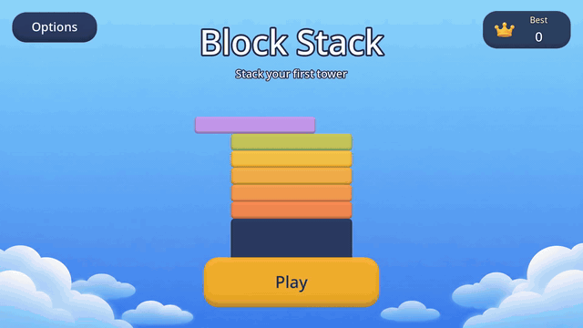

# open-game-works

[English](README.md)

미리 만들어 둔 코어 위에서 AI 에이전트가 서버-클라이언트 게임을 만든다. 상용 게임 수준을 목표로 한다.

https://github.com/user-attachments/assets/fb74b4ca-cc63-430d-af79-5b5118ec9c8a

https://github.com/user-attachments/assets/9cf4f284-32c5-4f82-9c3f-13d17cbc12ec

<table>
  <tr>
    <td align="center" width="50%"><br><a href="https://github.com/wnsrn3436/open-game-works-game-iso-survivors">iso-survivors</a>: 아이소메트릭 3D 호드 서바이벌</td>
    <td align="center" width="50%"><br><a href="https://github.com/wnsrn3436/open-game-works-game-mana-clash">mana-clash</a>: 1대1 카드 배틀</td>
  </tr>
  <tr>
    <td align="center" width="50%"><br><a href="https://github.com/wnsrn3436/open-game-works-game-pong">pong</a>: CPU와 대결하는 패들 게임</td>
    <td align="center" width="50%"><br>card-duel: AI와 겨루는 실시간 카드 배틀. open-game-works의 아주 초기 버전으로 만들었다 (저장소 비공개)</td>
  </tr>
  <tr>
    <td align="center" width="50%"><br><a href="https://github.com/wnsrn3436/open-game-works-game-block-stack">block-stack</a>: 원탭 블록 쌓기</td>
  </tr>
</table>

open-game-works는 AI 에이전트가 서버-클라이언트 게임을 만드는 하네스다. 재미와 완성도 모두 상용 게임 수준에 이르는 것을 목표로 한다.

- 여러 게임이 똑같이 다시 만들게 될 기능(인프라, 라이브 운영, 스토어 정책, 메타 시스템)은 **코어**로 미리 만들어 둔다. 에이전트는 게임플레이만 **콘텐츠 코드**로 작성한다.
- 사람은 `create game: <game>` 같은 명령 하나를 내린다. 명령을 받은 에이전트가 역할별 하위 에이전트를 부르며 수정, 검사, 판정의 루프를 멈출 때까지 돌리고 끝나면 보고한다.
- 재미는 이전 버전과 블라인드로 비교하며 직접 플레이하는 판정 에이전트들이 판정한다. 완성도는 자동 검사(봇 플레이테스트, 프로파일링, UI 캡처)가 판정한다.

이 저장소는 하네스다. 에이전트가 따르는 규칙, 에이전트가 읽는 스킬과 코어 모듈 명세, 설정, CLI `ogw`가 들어 있다. 이 폴더에서 연 Claude Code 또는 Codex 세션에서 쓴다.

## 현재 상태

한창 개발 중이다. macOS에서 Claude Code(Claude Opus 5.5, high effort)로만 테스트했다. Codex CLI는 설정에서 지원하지만 테스트하지 않았다. `build` 명령은 아직 실행한 적이 없어서 빌드하거나 배포한 게임은 없다. 명령, 설정, 파일 형식은 앞으로 바뀔 수 있다.

## 빠른 시작

Apple silicon macOS, Node.js 24 이상, Git, GitHub CLI(`gh`, 로그인), Docker와 `docker buildx`, uv, Claude Code(로그인)가 필요하다. 나머지는 `update env`가 확인하고 엔진과 고정된 도구도 직접 내려받는다.

```sh
mkdir open-game-works && cd open-game-works
git clone https://github.com/wnsrn3436/open-game-works-core.git
git clone https://github.com/wnsrn3436/open-game-works-core-impl.git

cd open-game-works-core/tools && npm ci && cd ..
export PATH="$PWD/tools/bin:$PATH"   # 계속 쓰려면 전체 경로를 셸 프로필에 추가

# 플레이·판정 에이전트용 장기 Claude Code 토큰
claude setup-token
pbpaste | tr -d '[:space:]' | ogw secret set --harness claude-code-oauth-token

claude
```

그다음 그 Claude Code 세션에서 명령을 하나씩 내린다.

```
update env
setup game: block-drop a falling-block puzzle game for mobile, in English and Korean
create game: block-drop
```

1. `update env`는 이 호스트를 확인하고 엔진, 도구, 리소스 생성 방법을 설치한 뒤 선호 설정을 묻는다. 호스트마다 한 번 실행한다.
2. `setup game`은 `games/block-drop/`을 만들고 스스로 정할 수 없는 것을 묻는다. 레퍼런스 게임과 그 게임플레이 영상(파일 또는 YouTube URL)도 여기서 받는다.
3. `create game`은 루프가 멈출 때까지 돌리고 결과를 main에 병합한 뒤 보고한다. 중간에 사람을 기다리지 않는다.

완성된 게임을 먼저 해 보고 싶다면 위 예시 게임 하나를 `games/`에 클론하고 그 README를 따르면 된다.

## 작동 방식

```
사람 -- 명령 하나 --> 리드 에이전트 (사람이 연 Claude Code 또는 Codex 세션)
  반복마다:
    1. 콘텐츠 에이전트  디자인, 클라이언트·서버 코드, 데이터, contract, 플레이 가이드 수정
    2. 자동 검사        회귀 테스트, 정적 검사, 완성도 검사
    3. 플레이 에이전트  실제 입력으로 플레이하고 본 것을 보고 (완성도 반복만)
    4. 판정 에이전트들  이번 커밋과 기준 게임을 블라인드로 플레이 (판정 에이전트마다 A/B를 바꿈).
                        완성도 반복에서는 레퍼런스 게임 영상과도 비교
    5. ogw              투표 집계, 결함 목록 작성, 중지 여부 판정
  중지: success, repeated defect, oscillation, plateau, limit reached
  -> 루프 종료 기록, main에 병합, 사람에게 보고
```

- **두 종류의 반복.** 재미 반복은 재미를 노린 변경 하나를 시도하고 플레이를 막는 검사만 돌린다. 짧게 플레이해서 game feel, tension and release, no friction만 판정하므로 몇 분 안에 끝난다. 완성도 반복은 결함을 고치고 모든 단계를 돌린다. 성공은 완성도 반복에서만 판정한다.
- **한 명의 의견이 아니라 투표.** 판정 에이전트 여럿이 재미 요소마다 승자를 고른다. 판정 에이전트의 3분의 2 이상이 양쪽 A/B 배정 모두에서 같은 쪽을 골라야 그 요소가 정해진다. 측정할 수 있는 요소는 커밋마다 세 번 돌린 봇 텔레메트리로 정한다.
- **근거의 순서.** 자동 검사가 텔레메트리보다, 텔레메트리가 LLM 의견보다 우선한다. 확인하지 못한 것은 실패가 아니라 unknown으로 기록한다.
- **리소스와 번역은 루프를 막지 않는다.** 리소스·번역 하위 에이전트가 병행해서 일하는 동안 에이전트는 플레이스홀더 리소스로 개발을 이어 간다.

전체 규칙은 [AGENTS.md](AGENTS.md), [agents/](agents), [skills/](skills)에 있다. 이 README는 사람을 위한 소개이며, 내용이 다르면 그 파일들이 우선한다.

## 명령

| 명령 | 하는 일 |
|---|---|
| `update env` | 이 호스트를 확인하고 도구와 모델을 설치·측정한 뒤 선호 설정을 묻는다 |
| `setup game: <game> <request>` | 게임 저장소와 설정을 만들고 레퍼런스 게임과 영상을 받는다 |
| `create game: <game> [<request>]` | 루프로 게임을 만든다 |
| `update game: <game> <request>` | 만든 게임을 루프로 고친다. 사람의 피드백이나 PROD 문제 수정 |
| `build: <game> <DEV, STG, PROD> [<platform>...]` | 코드를 하드닝하고 다시 검사한 뒤 빌드한다. DEV와 STG는 서버도 배포하고, PROD 배포는 사람이 한다 |
| `update core: <proposal>` | 코어 제안이나 사람의 요청을 적용하고 새 코어 버전을 릴리스한다 |
| `create client core: <engine>` | 다른 엔진의 클라이언트 코어를 추가한다(Godot은 이미 있다) |
| `update harness tool: <request>` | `ogw`를 고친다 |

사람이 할 일: 명령을 내리고, 루프 종료 기록(`records/loops/<run>/end.md`, `## human` 절에 사람이 볼 것이 있다)을 읽고, 루프 밖에서 오는 질문에 답하고, `ogw secret set`으로 시크릿을 호스트의 시크릿 저장소에 넣고, PROD를 배포한다.

## 더 보기

### 전체 요구 사항

`update env`(`ogw env check`)가 아래를 확인하고 없는 것을 알려 준다.

| 요구 사항 | 용도 |
|---|---|
| macOS(arm64) 또는 Linux(x64) | 플레이·판정 에이전트가 OS 샌드박스(`sandbox-exec`, `bwrap`)에서 실행된다 |
| Node.js 24 이상, Git | `ogw`, 저장소와 워크트리 |
| GitHub CLI, 로그인 | 코어 릴리스 받기. 서버 이미지 푸시에는 `write:packages` |
| Docker와 `docker buildx` | 테스트와 빌드용 PostgreSQL, 서버 이미지 |
| uv와 Python | 생성 방법, `gdtoolkit` |
| Claude Code, 로그인 | 하위 에이전트, 원하면 리드 에이전트 |
| Codex CLI(선택) | 리드 에이전트, 또는 Codex로 바꾼 역할 |
| Xcode, Android SDK와 JDK 17, `jsign` | iOS·macOS 빌드, Android 빌드, Windows 빌드 서명 |

Windows: 클론하기 전에 개발자 모드를 켜고 `git config --global core.symlinks true`를 실행한다. 플레이·판정 샌드박스는 macOS와 Linux에서만 돌아가므로 Windows에서는 루프가 돌지 않는다.

### 워크스페이스 구조

```
<workspace>/
  open-game-works-core/            하네스 (여기서 Claude Code 또는 Codex 실행)
  open-game-works-core-impl/       코어 소스
  open-game-works-core-releases/   내려받은 코어 릴리스 (도구가 만듦)
  games/<game>/                    게임마다 저장소 하나
  worktrees/                       도구가 만들고 지움
  .ogw/                            엔진, 도구, 로컬 모델 (update env가 만듦)
```

### 설정과 시크릿

- 하네스 설정은 `settings.json` 위에 각자의 `settings.local.json`을 합친 것이다. 로컬 파일은 커밋하지 않으며 언어, 역할별 모델과 effort, 루프 값, 호스트별 값을 담는다. 게임 설정은 `games/<game>/settings.json`이다.
- 설정에는 시크릿 이름만 둔다. 값은 `ogw secret set --harness <name>`(표준 입력으로 읽음)으로 저장하고 `ogw secret show`로 본다. 저장소는 macOS에서는 별도 키체인, Linux에서는 `~/.local/share/ogw/` 아래 폴더다.
- `huggingface`(선택)는 가중치 접근이 제한된 `trellis2` 방법(3D 모델)에만 필요하다.

### 리소스 생성과 로컬 모델

`update env`는 `settings.json` `resourceGeneration`에 있는 방법을 설치한다. 이미지, 음악, 효과음, 음성은 로컬 모델(`flux2-klein`, `ace-step`, `moss-sfx`, `qwen3-tts`)이, 3D 모델은 `trellis2`나 `blender`가, 스프라이트 애니메이션은 `sprite-gen-codex`나 `sprite-gen-grok`이 만든다. 이 둘은 ChatGPT나 Grok 구독 사용량을 쓴다(API 키를 쓰면 호출마다 과금된다). 로컬 모델을 건너뛰려면 `update env` 전에 그 방법을 지운다. 어떤 리소스 종류를 만들 방법이 없으면 루프는 그 종류의 플레이스홀더로 돌지만 STG와 PROD 빌드는 막힌다.

## 기여

기여를 환영한다. 특히 도움이 필요한 곳:

- **리소스 생성.** 리소스 스킬([skills/resource/](skills/resource))과 생성 방법이 게임의 최종 그림, 애니메이션, 사운드를 만든다. 품질 향상, 한 게임 안의 일관된 스타일, 아직 만들 방법이 없는 리소스 종류의 새 방법은 모든 게임에 도움이 된다.
- 다른 엔진의 클라이언트 코어. 지금은 Godot뿐이고 Three.js, Phaser, Unity, Unreal이 목표다.
- 외부 서비스의 실제 어댑터(스토어 결제, 광고, 푸시, 소셜 로그인). 아직 실제 서비스로 시험해 보지 않았다.
- Windows, Android, iOS에서의 `build` 명령.
- open-game-works로 만든 게임, 그리고 코어가 부족했던 곳의 코어 제안.

질문과 아이디어는 [Discussions](https://github.com/wnsrn3436/open-game-works-core/discussions)에, 버그는 [Issues](https://github.com/wnsrn3436/open-game-works-core/issues)에 올린다. 큰 변경은 먼저 둘 중 하나를 연다. 코어 변경은 이 저장소의 모듈 명세에서 시작하고 [open-game-works-core-impl](https://github.com/wnsrn3436/open-game-works-core-impl)의 구현이 그 명세를 따른다. `ogw` 변경은 `tools/`의 `npm test`와 `tools/bin/ogw docs check`를 통과해야 한다. 하네스 파일, 코드 식별자, 커밋 메시지는 영어로 쓴다. 기여물은 Apache License 2.0으로 라이선스된다.

## 라이선스

하네스는 Apache License 2.0이다([LICENSE](LICENSE)). `.github/media/`의 게임플레이 GIF는 open-game-works로 만든 게임을 보여 주며 CC BY-NC-ND 4.0이다(`.github/media/LICENSE`).

| 저장소 | 라이선스 |
|---|---|
| [open-game-works-core](https://github.com/wnsrn3436/open-game-works-core) | Apache-2.0 |
| [open-game-works-core-impl](https://github.com/wnsrn3436/open-game-works-core-impl) | Apache-2.0. 서드파티 구성 요소는 `licenses.json`에 있다 |
| 예시 게임 | 게임 자체 콘텐츠는 CC BY-NC-ND 4.0. `client/core/`와 `server/core/`는 Apache-2.0, 포함된 폰트는 SIL OFL 1.1을 유지한다. 생성한 에셋의 방법과 라이선스는 `resource/resources.csv`에 있다 |
